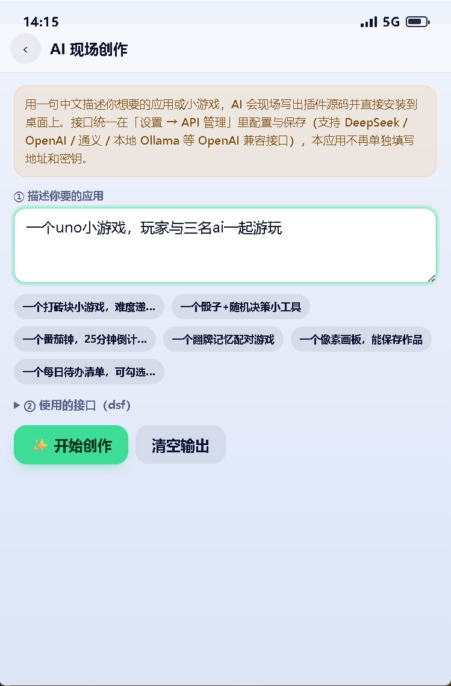

# ST Runtime Layer

> 在 **SillyTavern**（AGPL-3.0）之上实现的一层运行时：
> 让 AI 的输出不只是给人读的文本，而是**给机器执行的指令**。


左边是模型吐出来的原文，右边是用户看到的界面。**中间那层正则，就是整个系统的接口层。**

| 1100 | 10 万 | 8831 | 7 |
|---|---|---|---|
| 单角色单存档轮次 | 全部存档累计回合 | 单次生成 token | 系统模块 |

---

## 我做了什么 / 没做什么

| ⬤ 本仓库包含（我写的） | ○ 不在本仓库（第三方） |
|---|---|
| 标签协议：5 类标签的语法与语义 | SillyTavern 本体源码 |
| 正则中间件：解析、分流、容错降级 | 任何模型训练 |
| 前端运行时：组件挂载、悬念折叠、样式隔离 | 生图 / TTS 的服务端实现 |
| 提示词 DSL：分块预设 + 禁词表 + 强制 planning | 角色卡中的剧情文本 |
| 记忆层：向量召回 + 递进摘要 + 故事/信息二分 | 模型权重、任何 API 密钥 |
| 插件加载器：AI 现场写应用并安装到桌面 | — |

**边界说明**：本仓库不含 SillyTavern 源码，也不修改它。所有代码通过 ST 的扩展接口加载。
详见 [NOTICE.md](NOTICE.md)。

---

## 它解决什么

SillyTavern 本质上是一套提示词系统：预设结构决定这次发什么，模型返回文字，仅此而已。
它能写得很动人，但用户看到的永远只有一行字。三条硬边界：

| 边界 | 具体表现 | 后果 |
|---|---|---|
| 只有文字 | 角色说「我给你调了杯酒」，屏幕上还是那行字 | 沉浸感断裂 |
| 没有状态 | 时间、天气、随身物品、手机界面都不存在 | 角色活在真空里 |
| 没有记忆管理 | 上下文一长就遗忘、人设漂移、token 爆炸 | 长线剧情跑不动 |

我要做的不是「更好的提示词」，是给这套提示词系统加一层运行时——让 AI 的输出成为**给机器执行的指令**。

> **标签即 API，正则即中间件，前端即运行时。**

---

## 四个 demo

| Demo | 展示什么 |
|---|---|
| **街机（双人）** | 正文里出现一台真能打的街机，2P 协战，**必须通关才解锁后续剧情** |
| **AI 现场创作** | 一句中文 → AI 写插件源码 → 装到桌面 → 直接开局 UNO |
| **手机 OS 桌面** | 便签 138 条 · 动态 · 息屏 · 阅读器 —— 对话之外的第二个界面 |
| **音乐 + 选项** | 播放器卡 + 四个角色化选项，标签协议的最小可见形态 |

<p>



</p>

### 交互设计的关键：悬念折叠

如果用户先看到「门开了」，再点「开门」，交互就成了摆设。
所以交互触发前，标签之后的正文先被**折叠**；用户完成动作，才展开。

> 交互的时间顺序，比交互本身更重要。

---

## 标签协议

| 标签 | AI 输出 | 解析后发生什么 | 依赖 |
|---|---|---|---|
| **时间** | `<bbs_start>2024/10/3 12:08</bbs_start>` | 前端显示数字时钟，随剧情推进 | 纯前端 |
| **音乐** | `<music_recommend><title>…` | 播放器卡片，前台载入 | 联网检索 + 播放器 |
| **图片** | `雨夜的霓虹街道</img>` | 调用生图 API，返回图片卡片 | 生图 API |
| **语音** | `[莫蒂默, 温和无奈] "…"` | GPT-SoVITS 用该角色音色合成，替换为语音条 | 本地 TTS + 自训音色 |
| **交互** | `<interact>拉开车门</interact>` | 副 AI 生成 HTML/CSS/JS，渲染成可点击组件 | 副 AI + 前端注入 |

完整语法、容错与降级规则见 **[docs/tag-protocol.md](docs/tag-protocol.md)**。

> 提示词层的输出格式，就是这套系统的 API 契约。改一个字，下游就崩——
> 所以它必须像接口一样被设计，而不是像文章一样被写。

---

## 记忆与成本

不做摘要时，每回合仅正文就让上下文至少增加 1500 token；1000 回合累计约 **750 万 token**。
改成向量召回 + 递进摘要 + 「故事 / 信息」二分摘要后，单次生成稳定在 **8831 token**，压缩后的历史摘要约 5000 token。

> **事件会过期，人设不会。** 混在一起摘要，模型会把「她昨天喝了酒」和「她讨厌被命令」当成同等权重的事实。

---

## 架构


**为什么是三个 AI**：单一模型要同时负责「写得好看」和「判断哪里该交互」，两个目标会互相打架。
拆成三段流水线后——主 AI 只写正文，副 AI-1 判定互动点，副 AI-2 只生成前端代码——
文字质量不下降，判定与生成的上下文干净，出错可定位、可单独重跑。

细节见 [docs/architecture.md](docs/architecture.md)。

---

## 仓库结构

```
.
├── README.md
├── NOTICE                第三方来源与许可声明
├── assets/               截图（已压缩）
├── demo/index.html       分镜演示页，单文件，双击即可打开
├── docs/
│   ├── architecture.md   六层架构与数据流
│   ├── tag-protocol.md   标签协议规范
│   ├── portfolio.pdf     作品集（10 页）
│   └── portfolio.md      作品集文字稿
├── preset/               提示词分块（脱敏）
├── regex/                五组正则中间件（JSON 导出）
├── frontend/             组件挂载与悬念折叠
├── memory/               向量召回 + 摘要
└── plugins/              AI 现场创作生成的插件示例
```

---

## 局限

- 个人系统，没有真实用户数据；「效果」是长期调参的体感 + 少量朋友试用，样本极小。
- 标签协议是我自己定的，没有标准化，换模型 / 换前端就要重适配。
- 三 AI 编排成本高于单模型，只在「长线剧情」这一场景证明了它值。
- 提示词规则越多，模型越容易「表演遵守」，需要定期重读产出、淘汰失效规则。

---

## 许可

本仓库代码由 倪若冰 编写，AGPL-3.0。
运行所依赖的 [SillyTavern](https://github.com/SillyTavern/SillyTavern) 亦为 AGPL-3.0，本仓库不含其源码。
详见 [NOTICE.md](NOTICE.md)。
