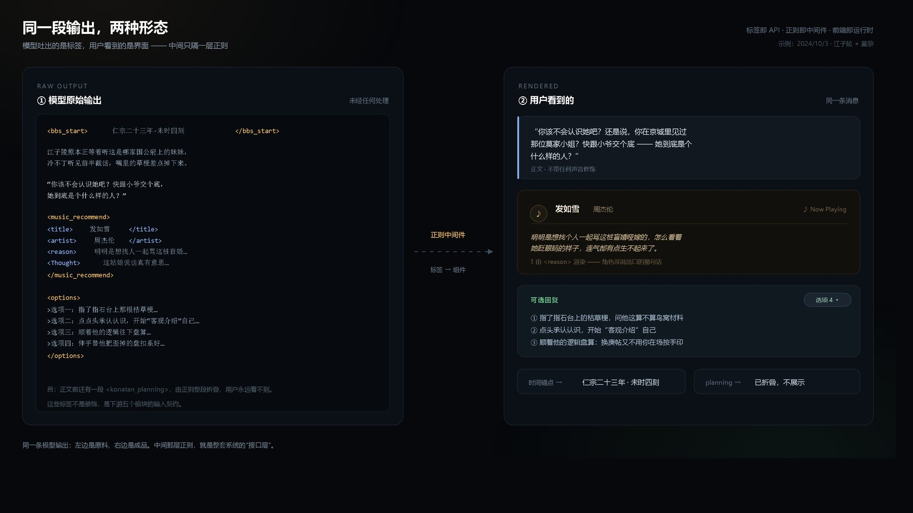
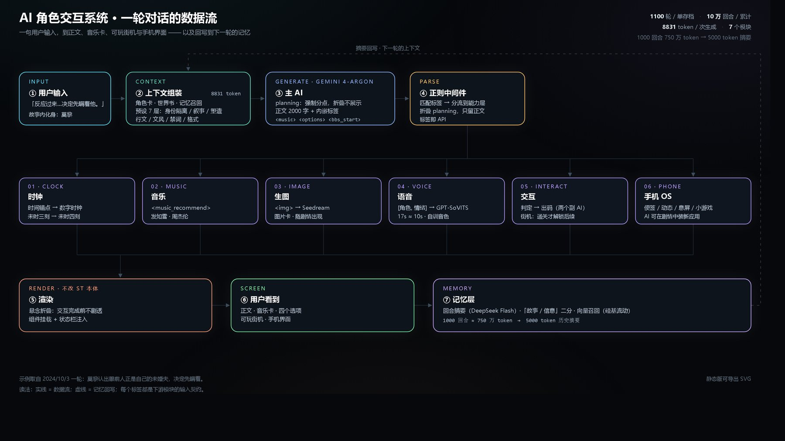
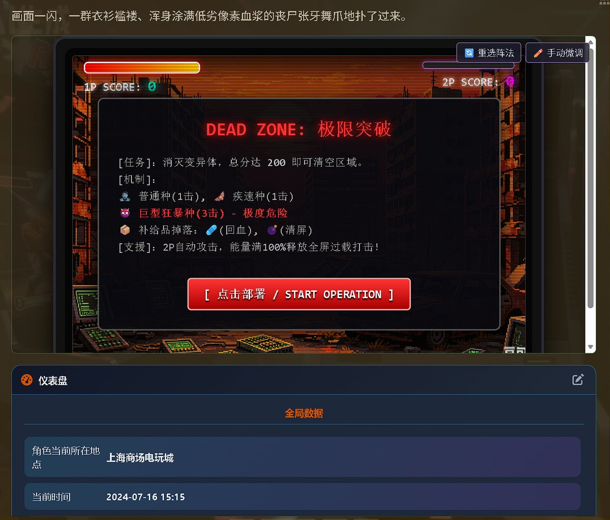
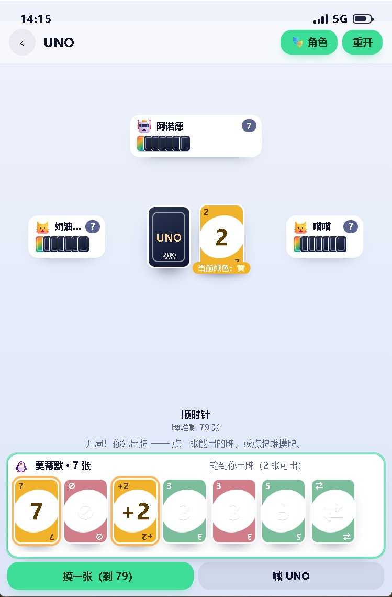

# talkaboutweili

> 一套长期在用的 AI 角色对话系统。主线是一个判断：
> **模型只会吐文字，所以我让它吐"标签"，由中间件把标签翻译成组件。**
>
> 本仓库公开其中两块最可复用的部分：**切好块的提示词（[preset/](preset/)）** 和 **九条正则中间件（[regex/](regex/)）**。

左边是模型吐出来的原文，右边是用户看到的界面。**中间那层正则，就是整个系统的接口层。**

---

## 一、本仓库有什么

| 目录 | 内容 | 一句话 |
|---|---|---|
| [preset/](preset/) | 6300 字完整预设，切成 **13 块** | 提示词不是文案，是 13 个可单独替换的模块 |
| [regex/](regex/) | **9 条** ST 正则脚本 | 不是滤镜，是显示层 / 提示词层分离的中间件 |
| [demo/](demo/index.html) | 单文件分镜演示页（9 幕，自动播放） | 零依赖，双击就能看，也能直接丢服务器 |
| [docs/](docs/) | 标签协议规范、架构说明、作品集 PDF | 协议先于实现 |
| [assets/](assets/) | 截图（已压缩） | — |

---

## 二、系统全貌（本仓库只覆盖其中两块）

| 层 | 是否在本仓库 |
|---|---|
| ① 提示词层（预设分块、角色卡、世界书） | ✅ **[preset/](preset/)** |
| ② 主 AI 与三段式编排 | ○ 不在（依赖外部模型与自建服务） |
| ③ 正则中间件（解析、分流、容错） | ✅ **[regex/](regex/)** |
| ④ 前端渲染层（组件挂载、悬念折叠、手机 OS） | ○ 不在本仓库 |
| ⑤ 记忆层（向量召回 + 递进摘要） | ○ 不在本仓库 |

> 这一栏是刻意标出来的：**能说清"哪部分不是我做的、不在我仓库里"，
> 比把所有东西都算成自己的更可信。**

---

## 三、三件可以当场验证的事

### 1. 预设切成了 13 块，其中 9 块跨角色可复用

[preset/README.md](preset/README.md) 里有一张表，把 13 块分成骨架 / 皮肤 / 接口三类：

- **骨架**（跨角色不动）：认知隔离、行文规则、正文约束、思考模板
- **皮肤**（每个角色重写）：身份、文风、禁词、角色槽位
- **接口**（与正则绑定）：时间锚点、播放器格式

**换角色 = 换 4 块，不动 9 块。** 这就是"框架"和"一篇文章"的区别。

### 2. 正则的顺序本身就是逻辑

`09-planning折叠面板` 要把 planning 渲染成卡片，`01-剥离脚手架` 要把 planning 整段删掉——
**作用于同一段文本，结论相反。** 顺序只能是 09 先、01 后：09 先消费掉原始标签，01 才匹配不到。

反过来 planning 就被整段吃掉，面板永远不出现。

### 3. 规则是可以验收的

[preset/example/](preset/example/README.md) 里放了一份真实产出，按预设逐条检索：

| 规则 | 要求 | 实际 |
|---|---|---|
| 对白禁「说道问」 | 0 | 仅 1 处，且在对白内 |
| 只用暗喻 | 0 明喻 | 0 处「像 / 仿佛」 |
| 杀死主观描写 | 0 | 0 处「觉得」 |
| 禁止数字 3 | 0 | 0 处（全篇用两、四、五、十九、四十规避） |
| 对白占比 | ≥40% | **42.5%** |
| 正文字数 | ≥1300 token | **2067 字** |
| **planning 字数** | **≤1500** | **2209** ⚠️ 超标 |

最后一行是故意的：**规则写出来 ≠ 规则被执行。** 留一条没达标的在文档里，
比写一句"效果很好"有用。

---

## 四、标签协议

| 标签 | AI 输出 | 解析后发生什么 |
|---|---|---|
| **时间** | `<bbs_start>2026/11/21 19:15</bbs_start>` | 前端数字时钟；记忆层据此切片建时间线 |
| **音乐** | `<music_recommend><title>…` | 播放器卡片 + 联网检索 |
| **图片** | `雨夜的霓虹街道</img>` | 调用生图 API，返回图片卡片 |
| **语音** | `[角色, 情绪] "…"` | GPT-SoVITS 用该角色音色合成，替换为语音条 |
| **交互** | `<interact>拉开车门</interact>` | 副 AI 生成 HTML/CSS/JS，渲染成可点组件 |

完整语法、容错与降级规则见 **[docs/tag-protocol.md](docs/tag-protocol.md)**。

> 提示词层的输出格式，就是这套系统的 API 契约。改一个字，下游就崩。

---

## 五、演示

单文件演示页：[demo/index.html](demo/index.html)（9 幕，约 80 秒，空格/方向键切换，`#3` 可直达第 3 幕）

---

## 六、数字

| 指标 | 数值 |
|---|---|
| 单角色单存档对话 | **1100 轮** |
| 全部存档累计 | **约 10 万回合** |
| 单次生成上下文 | **8831 token** |
| 预设分块 | **13 块** |
| 正则脚本 | **9 条** |

---

## 七、局限

- 个人系统，没有真实用户数据；「效果」是长期调参的体感 + 少量朋友试用，样本极小。
- 标签协议是我自己定的，没有标准化，换模型 / 换前端就要重适配。
- 规则会失效：上面的 planning 字数就是证据，必须定期抽检重读。
- 本仓库只包含提示词与正则两块，前端渲染与插件加载不在其中。

---

## 八、许可

本仓库内容由 倪若冰 编写，AGPL-3.0。
运行所依赖的 [SillyTavern](https://github.com/SillyTavern/SillyTavern) 亦为 AGPL-3.0，本仓库不含其源码。
详见 [NOTICE.md](NOTICE.md)。
