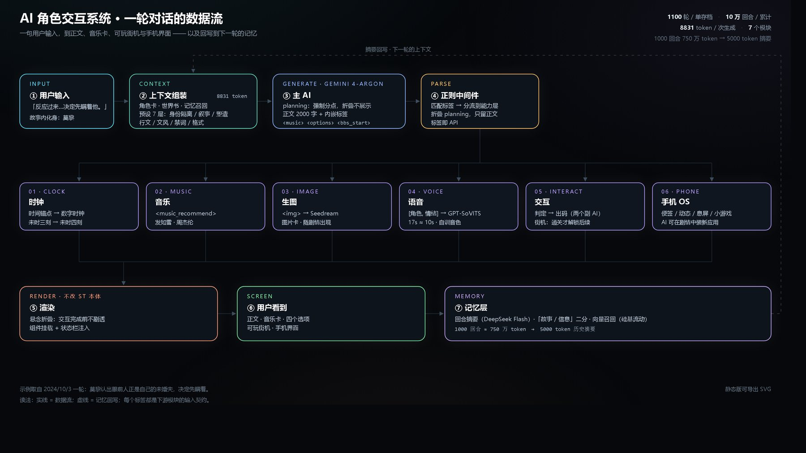

# 架构与数据流



---

## 一句话

**标签即 API，正则即中间件，前端即运行时。**

- AI 不需要会写代码，只要在正确的位置吐出正确格式的标签；
- 正则层是解析器，把"自然语言里的指令"翻译成"系统调用"；
- 前端是运行时，把系统调用的结果渲染成用户能看见、能点的东西。

---

## 六层

| # | 层 | 职责 | 关键设计 |
|---|---|---|---|
| ① | 提示词层 | 决定"这一次发什么" | 预设固定消息顺序；角色卡（是谁）与世界书（世界怎么运转）分离；按功能分块，可单独替换做 A/B |
| ② | 主 AI | 只写正文 | 先 `planning` 再输出正文 + 内嵌标签；追求文字质量与角色一致性 |
| ③ | 编排层 | 副 AI-1 判定互动点、副 AI-2 生成前端代码 | 三段流水线，两个副 AI 的上下文互不污染 |
| ④ | 中间件 | 解析五类标签、分流、容错降级 | 纯正则，不依赖模型"配合" |
| ⑤ | 渲染层 | 组件挂载、悬念折叠、手机 OS 桌面 | **不修改 ST 本体**，通过扩展接口挂载 |
| ⑥ | 记忆层 | 向量召回 + 递进摘要 + 故事/信息二分 | 把上下文预算压在 8831 token |

---

## 数据流

```text
用户输入
   │
   ▼
① 提示词层：预设结构 + 角色卡 + 世界书 + 记忆摘要（8831 token 预算）
   │ 组装 prompt
   ▼
② 主 AI：planning → 正文 + 内嵌标签
   │ 正文
   ├──────────────► ③ 副 AI-1：判定哪段描写该变成可交互动作 → 注入 <interact>
   │
   ▼
④ 正则中间件：时间 / 音乐 / 图片 / 语音 / 交互 五类标签分流
   │                    │
   │                    └──► ③ 副 AI-2：标签 → HTML/CSS/JS
   ▼
⑤ 渲染层：流式正文 + 组件挂载 + 悬念折叠 + 手机 OS 桌面
   │
   ▼
⑥ 记忆层：向量召回 + 回合摘要（DeepSeek Flash）+ 故事/信息二分
```

---

## 为什么是三个 AI

单一模型做不了这件事，因为它要同时负责"写得好看"和"判断哪里该交互"，两个目标会互相打架。

| 角色 | 只负责 | 输入 |
|---|---|---|
| 主 AI | 写正文 | 完整预设 + 记忆 |
| 副 AI-1 | 判断本回合哪些描写应转成交互，包进 `<interact>` | **最近两回合** |
| 副 AI-2 | 把标签内内容变成 HTML/CSS/JS | 只有标签内容 |

**收益**：

1. 主 AI 的注意力不被"写代码"占用，文字质量不下降；
2. 判定与生成的上下文干净，出错可定位、可单独重跑；
3. 换模型时只需替换对应环节，不必重调整条链路。

**代价**：成本高于单模型，只在"长线剧情"这一场景证明了值。

---

## 渲染层：在不破坏 ST 的前提下，做它不让做的事

SillyTavern 对前端脚本有保护，直接注入 JS 会被拦住。做法是**不修改本体、不破坏它的脚本保护**，在前端挂载交互组件。

两个关键设计：

1. **悬念折叠**——交互触发前，把标签之后的正文先折叠；用户完成动作后才展开。
   这是交互设计而非技术实现：解决的是"提前给结果，交互就没意义了"。
2. **手机 OS 桌面**——对话之外挂了一套手机界面（便签 138 条 / 动态 / 息屏 / 阅读器 / 小游戏）。
   最特别的是 **AI 现场创作**：用一句中文描述想要的应用，AI 现场写出插件源码并直接安装到桌面。

---

## 记忆层：把 8831 token 花在刀刃上

长线剧情的敌人不是模型不够强，是**上下文被无差别地塞满**。

| 手段 | 做法 |
|---|---|
| 向量召回 | 把历史切片，按当前语境召回相关片段，而不是全量塞入 |
| 递进摘要 | 每回合先概括本回合，再按固定回合数做二次、三次摘要 |
| 摘要二分 | **故事** = 过去发生了什么（事件线）；**信息** = 这个角色是个怎样的人（人设线） |

**结果**：单次生成稳定在 8831 token。
对照：不做摘要时每回合正文 +1500 token，1000 回合约 750 万 token；压缩后摘要约 5000 token。

> 二分的直觉：**事件会过期，人设不会。**
> 混在一起摘要，模型会把"她昨天喝了酒"和"她讨厌被命令"当成同等权重的事实。

---

## 成本架构

| 环节 | 用什么 | 为什么 |
|---|---|---|
| 主写作 | 旗舰模型 | 文笔是唯一值得花旗舰模型的地方 |
| 剧情总结 / 归纳 | 轻量模型（DeepSeek Flash） | 压缩是机械劳动，便宜模型足够 |
| 向量记忆与召回 | 免费向量小模型 | 召回只要"够准"，不需要贵 |
| 生图 | 生图 API | 不自建推理，省运维 |
| 语音 | 本地 GPT-SoVITS（自训音色） | 音色是独占资产，必须本地 |

核心判断：**把"智能"集中在写作一步，其余全部下沉到便宜模型、免费 API 和本地。**
